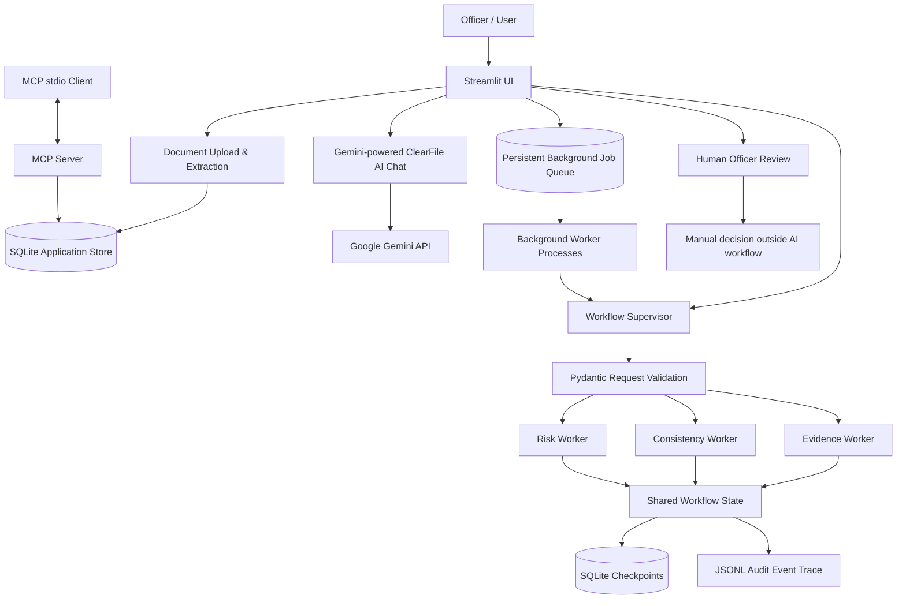

# ClearFile Architecture

## Trust boundary
- The AI workflow can summarize, compare, and flag evidence. It cannot set an approval/rejection decision.
- Gemini chat requests and selected application context are sent to Google's Gemini API when the feature is used; use fictional sample data in demonstrations.
- MCP tools are read-only and expose only local application summary/field findings.
- Checkpoints, job queue and audit trace are local files under `data/`; do not commit them to Git.
